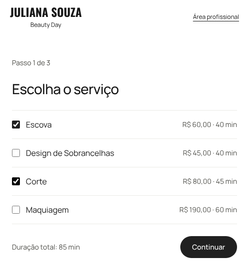
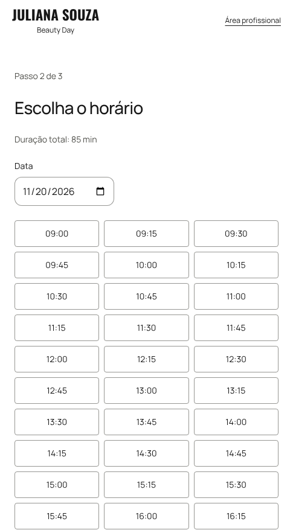
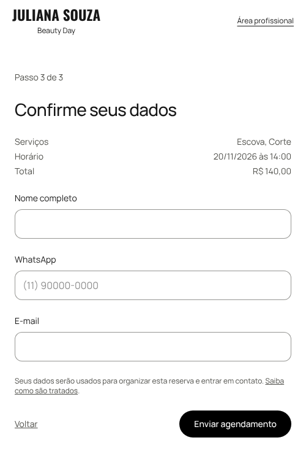
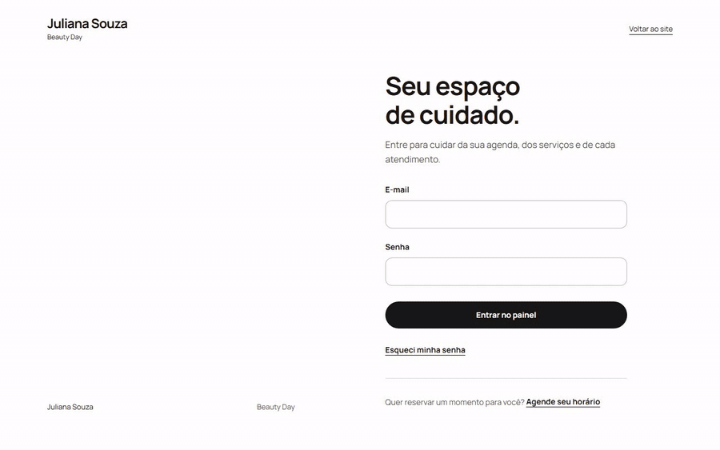

# Beauty Day Juliana

Sistema de agendamento online para um salão de beleza real, com uma única profissional. A cliente escolhe os serviços e um horário livre pelo celular; a proprietária aprova o pedido no painel e avisa a cliente pelo WhatsApp com a mensagem já escrita.

**Em produção:** https://beauty-day-juliana.vercel.app


## O problema

Combinar horário por mensagem exige, a cada pedido, descobrir quais serviços a cliente quer, somar quanto tempo levam e achar um espaço livre na agenda. O sistema faz essa conta sozinho e só mostra horários que cabem, deixando para a profissional apenas a decisão de aceitar.

## Como funciona

**Cliente (sem login)**
1. Escolhe um ou mais serviços. O sistema soma a duração e o preço.
2. Vê só os horários em que o atendimento inteiro cabe, dentro do expediente e com pelo menos 2 h de antecedência.
3. Envia o pedido e recebe um comprovante dizendo que ele está **aguardando confirmação**.

<p>
  
  
  
</p>

Escova + corte somam 85 min. O último horário oferecido é 16:30, porque o atendimento inteiro precisa terminar dentro do expediente.

**Proprietária (painel em `/painel`)**
- Agenda por dia, semana ou mês, com bloqueios de horário.
- Aprova, reagenda, recusa ou cancela pedidos. Pedidos feitos no expediente expiram em 120 min sem resposta.
- Botão **"Avisar cliente no WhatsApp"**: abre o WhatsApp dela com a mensagem pronta para aquela situação (confirmado, cancelado, recusado). Ela confere e envia.
- Cadastra serviços, preços, duração e horário de atendimento.
- Edita os textos e as fotos do site sem mexer em código.



Gravado num projeto Supabase separado, só com dados fictícios; o tempo de carregamento foi cortado.

## Stack

| Camada | Tecnologia |
| --- | --- |
| Front e back | Next.js 16 (App Router, Server Components, Server Actions), React 19, TypeScript estrito |
| Estilo | Tailwind CSS 4, identidade visual baseada em template Canva escolhido pela cliente |
| Banco e login | Supabase (PostgreSQL, Auth, Storage) |
| Validação | Zod no servidor |
| Testes | Vitest + PGlite (banco em memória), Playwright (E2E) |
| Deploy | Vercel |

## Decisões técnicas que valem destacar

- **Nunca dois clientes no mesmo horário.** A regra está no banco, não só no front: uma *exclusion constraint* do PostgreSQL rejeita qualquer intervalo sobreposto, inclusive com bloqueios. Duas reservas simultâneas para o mesmo horário: só uma é gravada (há um teste para isso).
- **O preço e a duração são calculados no servidor.** O navegador só envia os IDs dos serviços. Se o preço mudar enquanto a cliente está na tela, o pedido é recusado em vez de gravar um valor que ela não viu.
- **Histórico congelado.** A reserva guarda nome, preço e duração de cada serviço no momento do pedido. Mudar o catálogo depois não altera reservas antigas.
- **Autorização em duas camadas.** Estar logado não basta: cada ação do painel confere no servidor se o usuário é a proprietária, e as políticas RLS do banco bloqueiam o acesso direto.
- **Fuso horário.** Tudo é salvo em UTC e exibido em `America/Sao_Paulo`.
- **WhatsApp por link, não por API.** A API oficial da Meta exige conta Business verificada, templates aprovados e custo por conversa. Para um salão com uma profissional, um link `wa.me` com a mensagem pronta resolve: custo zero, e nada sai sem ela conferir.
- **Segurança.** Limite de requisições, cabeçalhos CSP com nonce, cookies `HttpOnly`/`Secure`, upload de imagem reprocessado no servidor (sem EXIF, até 4 MB).

## Testes

```bash
npm test -- --maxWorkers=1   # unitários + transações no PostgreSQL em memória (PGlite)
npm run lint
npm run build
npx playwright install chromium --only-shell   # só na primeira vez
npm run test:e2e             # Playwright; escrita só em ambiente de homologação
```

Os testes cobrem cálculo de horários livres, validação, autorização, conflito de reservas e montagem das mensagens de WhatsApp. Nenhum teste grava no banco real do salão.

## Rodar localmente

Requisitos: Node.js 22+ e um projeto Supabase (o gratuito serve). Sem as chaves do Supabase no `.env.local`, todas as páginas respondem erro 500.

```bash
npm ci
cp .env.example .env.local   # preencher NEXT_PUBLIC_SUPABASE_URL, NEXT_PUBLIC_SUPABASE_ANON_KEY e SUPABASE_SERVICE_ROLE_KEY
npm run dev                  # http://localhost:3000
```

Antes do primeiro `npm run dev`, prepare o banco:

1. Aplique `supabase/migrations/0001_initial_schema.sql` e `0002_seed_services.sql`.
2. Crie **uma** conta confirmada em Supabase → Authentication. Ela será a proprietária.
3. Aplique as migrations restantes em ordem de nome. A `20260917030419_owner_and_atomic_booking.sql` vincula aquela conta ao painel e recusa o ambiente se houver zero ou mais de uma conta.
4. Entre em `/login` com essa conta e cadastre os serviços em `/painel/servicos`.

Detalhes (reset de banco, recuperação de senha, publicação na Vercel) estão no [guia de desenvolvimento](docs/DESENVOLVIMENTO.md).

## Próximos passos

- Ambiente de demonstração separado, com login de teste para o painel.
- E-mail próprio (SMTP) para a recuperação de senha.
- Backup testado do banco.

## Documentação

[Guia de desenvolvimento](docs/DESENVOLVIMENTO.md) · [Requisitos](docs/PRD.md) · [Arquitetura](docs/ARCHITECTURE.md) · [Regras](docs/RULES.md) · [Tarefas](docs/TASKS.md) · [Revisão de segurança](docs/reviews/2026-10-07-finalizacao/SEGURANCA.md)

---

Desenvolvido por **Daniel Duarte** · [GitHub](https://github.com/duartedaniel92) · [LinkedIn](https://linkedin.com/in/duartedaniel92)
