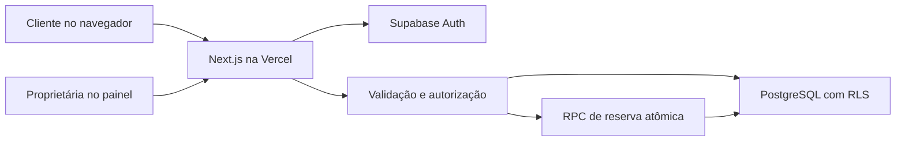

# ARCHITECTURE — Arquitetura técnica

Status: padrão aprovado em 29/09/2026. Stack flexível com alternativas justificadas; diagrama e modelo de dados obrigatórios em cada projeto.

## Finalidade

Explicar como o sistema funciona e os motivos das escolhas técnicas.

## Estrutura proposta para cada sistema

- Visão geral e diagrama dos componentes.
- Stack e justificativas, incluindo alternativas descartadas.
- Organização de pastas e responsabilidades.
- Modelo de dados, relacionamentos e integridade.
- Autenticação, autorização e limites de confiança.
- Contratos de API/actions, integrações e tarefas em segundo plano.
- Ambientes, publicação, observabilidade e estratégia de testes.
- Limitações, riscos e decisões arquiteturais.

## Estado conhecido deste projeto

Next.js App Router, TypeScript, React, Tailwind e Supabase/PostgreSQL. Server Actions validam entradas; operações administrativas verificam o vínculo com a proprietária. A RPC de reserva mantém gravação e snapshots na mesma transação; restrição de exclusão impede sobreposição. Hospedagem na Vercel. WhatsApp oficial ainda não integrado.

## Diagrama atual

## Modelo de dados atual

| Entidade | Responsabilidade e relações |
| --- | --- |
| auth.users | Identidade e autenticação |
| salon_owner | Uma proprietária; referência única a auth.users |
| services | Catálogo, preço em centavos, duração e indicador ativo |
| business_hours | Um registro por dia da semana; abertura, fechamento e funcionamento |
| appointments | Reserva ou bloqueio; intervalo sem sobreposição; contato na reserva |
| appointment_services | Liga reserva e serviço; conserva snapshots de nome, preço e duração |
| appointment_history | Histórico das decisões administrativas |
| rate_limit_buckets | Contadores compartilhados, identidades HMAC e expiração |
| booking_submissions | Idempotência por navegador, fingerprint e reserva; gravação transacional |
| site_content | Conteúdo público estruturado em registro único, versão otimista |
| service_media | Foto/texto alternativo associados ao ID do serviço; leitura pública somente quando ativo |

Fonte executável: migrations em `../supabase/migrations`. Não editar migrations aplicadas. Estados pendentes e decisões estão implementados; outbox/worker/webhook WhatsApp ainda não existem.

Storage `beauty-site` é público para fotos publicadas. Escrita só pelo servidor após autorização e reprocessamento Sharp; nenhum upload direto de authenticated. `/painel/site` reutiliza estilos e catálogo. Validação compartilhada em `lib/site-content.ts`; leitura SSR em `lib/site-data.ts`; gravação em `lib/actions/site.ts`. Paths controlados, sem URL arbitrária; Next Image restrito à origem/caminho permitido.

Nonce CSP exige renderização dinâmica (`connection` no layout). Autenticação usa cookies HttpOnly no servidor; cliente Supabase de navegador foi removido por não ter consumidores. Acesso ao comprovante é por cookie assinado (sete dias), sem tratar UUID como autorização. Limites e requisição idempotente ficam no PostgreSQL, funcionando entre instâncias da Vercel.

## Pastas e responsabilidades

`app`: rotas e páginas; `components`: interface; `lib/actions`: operações do servidor; `lib/auth`: autorização; `lib/availability`: disponibilidade; `lib/supabase`: clientes e tipos; `supabase`: migrations; `e2e`: testes de navegador; `docs`: decisões e planejamento.

## Operação e limites

Ambiente local via Next.js; produção na Vercel com Supabase. Homologação separada é recomendação ainda a preparar, não uma infraestrutura confirmada. Vitest/PGlite valida comportamento local; Playwright atual exige cuidado por carregar `.env.local`. Sentry consta como padrão desejado, mas não está integrado. Ver análise de 29/09 em `reviews/2026-09-29/analise-projeto.md`.

## Manutenção proposta

Atualizar junto com mudanças de estrutura ou contratos. Documentar nomes de variáveis e finalidade; nunca valores secretos.
